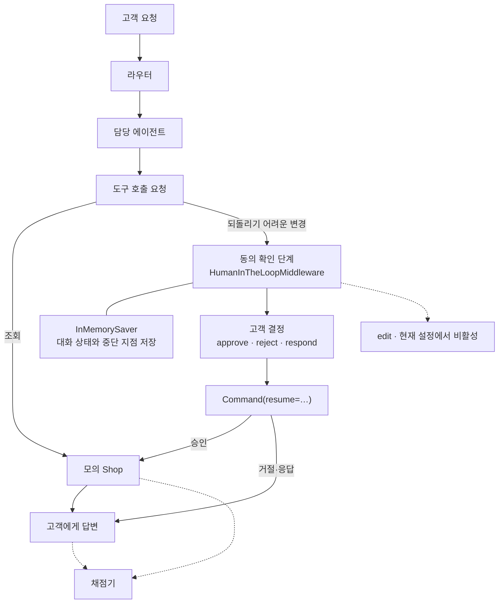

# ShopAgent

ShopAgent는 LangGraph와 LangChain으로 만든 한국어 쇼핑몰 고객 상담 에이전트 벤치마크입니다. 고정된 모의 쇼핑몰에서 대본이 있는 67개 시나리오와 110개 고객 턴을 실행합니다. 주문, 상품, 결제 같은 업무 도구는 네트워크 없이 합성 데이터로 동작합니다. 취소, 반품·환불 신청, 교환, 배송지 변경처럼 되돌리기 어려운 작업은 사람이 승인하는 동의 확인 단계를 거쳐야 실행됩니다. [시나리오 원본](data/scenarios.json) · [모의 쇼핑몰](shop/tools.py) · [동의 흐름](shop/graph_v2.py)

## v2 아키텍처



라우터가 요청을 담당 에이전트에 전달합니다. 변경 도구 호출이 중단되면 같은 대화의 체크포인트에서 고객 결정으로 재개합니다. 채점기는 저장된 도구 실행과 최종 DB 상태를 시나리오의 기대값과 비교합니다. [그래프](shop/graph_v2.py) · [채점기](shop/grader.py)

## 저장소 구성

```text
shopagent/
├── README.md
├── run.py
├── requirements.lock.txt
├── .gitignore
├── shop/
├── tests/
├── data/
├── notebooks/
├── scripts/
│   ├── chat_view.py
│   ├── llama_server_launcher.py
│   ├── summarize.py
│   ├── rescore.py
│   ├── build_data.py
│   ├── calibrate.py
│   └── legacy/
│       ├── compare_supervisor_omni_vs_gemma.py
│       ├── compare_consent_judge_omni_vs_gemma.py
│       └── build_classification_v31.py
└── docs/
    ├── worklog.md
    ├── review-scenarios.md
    ├── run-naming.md
    ├── consent-timing-analysis.md
    ├── upstage.env.example
    ├── policy/
    └── archive/
        ├── checkpoints/
        └── reports/
```

[작업 기록](docs/worklog.md)에서 실험 이력을, [시나리오 검토](docs/review-scenarios.md)에서 고객 대본과 기대 동작을 볼 수 있습니다. `runs/`는 로컬 실행 결과를 보관하는 폴더이며 GitHub에는 올라가지 않습니다. [.gitignore](.gitignore)

## 실행 방법

저장소 루트에서 `uv`로 가상환경을 만들고 잠금 파일의 패키지를 설치합니다.

```sh
uv venv .venv
uv pip sync --python .venv/bin/python requirements.lock.txt
.venv/bin/python -m unittest discover -s tests -q
```

현재 작업 환경에서 테스트 348개를 통과했습니다. 현재 코드는 `~/projects/kotest`의 모델·서버 보조 모듈도 가져오므로 새 작업 환경에서는 해당 모듈을 그 경로에 준비해야 합니다. [의존성 잠금 파일](requirements.lock.txt) · [공용 모듈 설정](shop/shared.py) · [테스트 소스](tests/)

로컬 Gemma로 전체 벤치마크를 실행합니다. 이 구성에는 로컬 `llama-server`, GGUF 모델 파일과 GPU가 필요합니다. 기본 그래프는 v2이며 v1은 `--graph v1`로 선택할 수 있습니다. [실행 옵션](run.py) · [모델 설정](shop/servers.py)

```sh
.venv/bin/python run.py --full --graph v2 --config g12-native
```

저장된 v2 결과는 오프라인 뷰어로 생성한 `chat_view.html`을 브라우저에서 열어 확인합니다. 뷰어는 모델 실행 없이 대화, 도구 호출과 채점 내역을 표시합니다. [뷰어 소스](scripts/chat_view.py)

```sh
.venv/bin/python scripts/chat_view.py
```

### WSL 로컬 llama-server 런처

WSL의 저장소 루트에서 아래 명령을 실행한 뒤 Windows 브라우저에서 `http://127.0.0.1:8765`를 엽니다. 런처는 `127.0.0.1`에서만 접속을 받습니다. `--port`로 런처 웹 포트를 바꾸면 브라우저 주소에도 같은 포트를 사용하세요.

```sh
.venv/bin/python scripts/llama_server_launcher.py
```

Gemma를 사용하는 노트북은 `18380` 포트의 `/health`에서 서버 상태를 확인합니다. 노트북을 실행하기 전에 런처에서 `g12-native`를 선택하고 **서버 시작**을 누른 뒤 **응답 준비 완료**가 뜰 때까지 기다리세요. **서버 중지**는 현재 런처에서 시작한 서버에 적용됩니다.

기본 실행 파일은 `~/llama.cpp/build/bin/llama-server`에, 모델은 `~/models/`에 둡니다. 설치 위치가 다르면 모델 경로는 화면에서, 실행 파일 경로는 런처의 `LLAMA_SERVER` 상수에서 바꿀 수 있습니다. 로컬 설정 목록은 `shop/servers.py`에서 읽습니다. Clef, pplx, Omni 설정은 각각 판단 모델 하나를 실행하며, Solar Pro 4는 원격 API이므로 실행 목록에서 제외됩니다. [런처 소스](scripts/llama_server_launcher.py) · [모델 설정](shop/servers.py)

## 벤치마크 결과

### 현재 v2 공식 HITL 결과

두 실행은 로컬 Gemma 12B(`g12-native`), `consent_mode=tool_interrupt`, `assist=off`로 67개 시나리오와 110개 고객 턴을 평가했습니다. 점수는 저장된 결과에서 성공한 고유 시나리오 수를 전체 고유 시나리오 수로 나눈 값입니다. [모델 설정](shop/servers.py) · [동의 시점 분석](docs/consent-timing-analysis.md)

| 실행 | 성공 / 전체 | 로컬 출처 |
| --- | ---: | --- |
| 최신 · 도구 설명 변경 | 41 / 67 | `runs/full-v2-gemma-tool-descriptions/results.json` |
| 이전 · 도구 실행 전 동의 | 43 / 67 | `runs/full-v2-gemma-tool-consent/results.json` |

최신 실행에서는 16개 시나리오의 23개 턴에 동의 확인 단계가 빠졌습니다. 반품 신청에서 수거 예약까지 이어지는 연쇄 시나리오의 통과는 두 실행 모두 0 / 6이었습니다. [턴별 분석](docs/consent-timing-analysis.md)

### 이전 실험 · v2 제안 방식

이전 v2는 `consent_mode=proposal`로 실행했습니다. 각 점수는 해당 파일에 저장된 고유 시나리오를 기준으로 합니다. 스키마 수정 전 Solar Pro 실행은 미실행 행도 포함합니다. Solar Pro 4 설정은 [실행 폴더 이름 규칙](docs/run-naming.md)에 설명되어 있습니다.

| 실행 | 성공 / 전체 | 로컬 출처 |
| --- | ---: | --- |
| 상품명 포함 및 도메인 사전 조회 | 60 / 67 | `runs/full-v2-item-names-domain-prefetch-decide-off/results.json` |
| 주문 사전 조회 | 59 / 67 | `runs/full-v2-order-prefetch-decide-off/results.json` |
| 고객 동의 표시만 적용 | 61 / 66 | `runs/full-v2-customer-card-only-decide-off/results.json` |
| 교정 규칙 끔 | 60 / 66 | `runs/full-v2d-off/results.json` |
| Solar Pro 4 | 25 / 67 | `runs/full-v2-solar-pro4/results.json` |
| Solar Pro 4 · 판단 스키마 수정 | 58 / 67 | `runs/full-v2-solar-pro4-decide-schema-fix/results.json` |

### 이전 실험 · v1 graph31 fixB

| 설정 | 성공 / 전체 | 로컬 출처 |
| --- | ---: | --- |
| Gemma 단독 (`g12-native`) | 53 / 60 | `runs/g12-native-graph31-fixB-r1/results.json` |
| Clef와 Gemma (`clef-g12`) | 56 / 60 | `runs/clef-g12-graph31-fixB-r1/results.json` |
| Omni와 Gemma (`jev-g12`) | 54 / 60 | `runs/jev-g12-graph31-fixB-r1/results.json` |
| pplx와 Gemma (`pplx-g12`) | 53 / 60 | `runs/pplx-g12-graph31-fixB-r1/results.json` |

## 설계 결정

- **실행 경계에서 동의를 받습니다.** 동의 확인 단계는 프롬프트 문구와 별개로 변경 도구 호출을 중단하고, 고객 결정이 들어오면 같은 대화 상태에서 재개합니다. [중단과 재개 구현](shop/graph_v2.py)
- **거절은 구조화된 결정으로 기록합니다.** `reject`를 받으면 보류 중인 요청을 닫고 거절한 도구와 주문을 대화 상태에 기록합니다. [거절 처리](shop/graph_v2.py)
- **실행 기록을 확인해 완료 안내를 검증합니다.** 답변의 완료 주장에 대응하는 성공 기록이 없으면 `false_completion` 위반 플래그를 남깁니다. [완료 판정](shop/grader.py)
- **v1을 비교 기준으로 보존합니다.** 테스트에서 v1 그래프 파일과 기존 프롬프트의 해시를 고정합니다. [v1 그래프](shop/graph.py) · [해시 테스트](tests/test_shop.py)

## 다음 작업

- 동의 확인 단계가 요청을 받은 턴에 뜨도록 고치고, 반품 접수부터 수거 예약까지 이어지는 흐름을 다시 검증합니다. [동의 시점 분석](docs/consent-timing-analysis.md)
- 추론 모드를 켠 Gemma(`thinking-on`)로 도구 호출과 동의 시점을 검증합니다.
- 추가 그래프 변경은 [`shop/graph_v2.py`](shop/graph_v2.py)에서 진행합니다. [`shop/graph.py`](shop/graph.py)는 고정된 비교 기준입니다.
